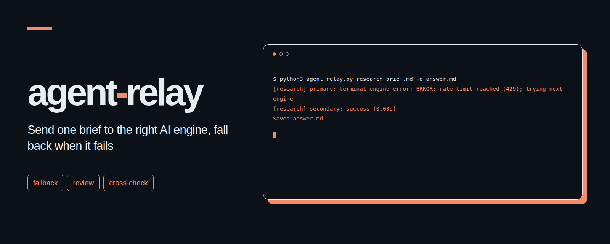

# agent-relay
<p align="center"></p>

지시서 한 장을 작업에 맞는 AI 엔진으로 보내고, 실행에 실패하거나 빈 답 또는 끝줄 오류 응답이 나오면 다음 엔진으로 넘기는 명령줄 도구입니다.

[English](README.md)

## 만든 이유

사용 한도에 걸리거나 프로세스 연결이 끊기거나 빈 응답이 돌아오면, 다른 구독이나 API가 남아 있어도 작업이 멈춥니다. agent-relay는 작업 종류마다 정해 둔 순서대로 엔진을 시도하고, 다음으로 넘긴 이유를 기록하며, 처음으로 얻은 정상 응답을 저장합니다. 사실 정확성을 점수로 매기거나 그럴듯하지만 실속 없는 답을 모두 걸러내지는 않습니다. 검토와 대조 모드에서는 내용을 검증하도록 구체적인 지침을 덧붙입니다.

파이썬 표준 라이브러리만 사용한 단일 파일로 구현되어 있습니다. 파일 잠금과 프로세스 그룹 시간 제한 기능을 쓰므로 Python 3.11 이상과 Linux 또는 macOS가 필요합니다. 별도 서버나 패키지 설치는 필요하지 않습니다.

## 설치 3단계

1. 이 저장소를 내려받아 해당 폴더로 이동합니다. 검토 모드에 필요한 `prompts/` 폴더는 `agent_relay.py` 옆에 그대로 둡니다.
2. 사용할 명령줄 엔진을 설치하고 인증을 마칩니다. API 엔진은 `api_key_env`에 적은 이름의 환경 변수로 키를 등록합니다.
3. `cp examples/relay.toml relay.toml`을 실행한 뒤 엔진 순서와 명령을 환경에 맞게 고칩니다. API 예시는 하루 예산 상한이 0으로 되어 있어 설정을 마치기 전에는 호출되지 않습니다.

```sh
python3 agent_relay.py research brief.md -o answer.md
python3 agent_relay.py code brief.md -o answer.md -C ./project --config relay.toml
python3 -m unittest -v
```

지시서, 출력 파일, 설정 파일의 경로는 명령을 실행한 폴더 기준입니다. `-C`는 이 경로들을 바꾸지 않고 엔진이 작업할 폴더만 바꿉니다. 상대 경로로 적은 `state_dir`은 설정 파일이 있는 폴더를 기준으로 삼습니다. 설치되지 않은 명령은 건너뛰고 다음 엔진으로 넘어갑니다.

## 모드

| 모드 | 동작 방식 |
| --- | --- |
| `research` | 설정된 조사 엔진을 순서대로 시도합니다. |
| `code` | 지정한 작업 폴더에서 코드 엔진을 순서대로 시도합니다. |
| `review` | 영어 또는 한국어 검토 규칙을 앞에 붙인 뒤 엔진을 순서대로 시도합니다. |
| `cross` | 서로 다른 두 엔진 항목에서 독립된 답을 하나씩 받은 뒤, 첫 답을 만든 엔진이 두 답의 차이를 원자료로 확인해 최종 답과 대조표를 작성합니다. |
| `write` | 설정된 글쓰기 엔진을 순서대로 시도합니다. |

검토 모드는 원자료로 확인되는 실제 오류만 파일과 줄 번호, 근거와 함께 짚어내도록 요구하며, 사소한 트집이나 스타일 취향은 빼고 지적할 내용이 없으면 `지적 0`으로 적도록 요청합니다. `review_language = "ko"`로 설정하면 `prompts/`에 있는 한국어 규칙을 사용합니다. 이 규칙은 프롬프트 지시문일 뿐 파일시스템 접근을 강제로 막는 샌드박스가 아닙니다. 실제 권한은 각 명령줄 엔진의 설정을 따릅니다.

대조 모드의 출력 파일이 `answer.md`이면 두 초기 응답은 `answer.md.a.md`와 `answer.md.b.md`로 저장됩니다. 앞의 두 단계에는 같은 지시서를 보내며 상대 엔진의 답을 보여주지 않습니다. 중간 파일은 두 응답이 모두 끝난 뒤에 저장합니다. 이어지는 비교 프롬프트에는 두 답을 함께 넣고, 의견이 갈린 부분과 확인된 값, 근거, 불확실성을 정리한 표와 최종 답을 요청합니다. 우선 지정한 엔진이 실패하면 다음 엔진이 첫 답을 만들 수 있지만, 두 번째 답은 반드시 다른 엔진 항목이 맡아야 합니다. 마지막 비교 단계는 첫 답을 만든 엔진만 사용하며, 그 엔진이 끝내지 못하면 전체 실패로 처리합니다. 설정 항목들도 실제로 서로 다른 엔진을 가리켜야 합니다. 작업 폴더는 공유하므로 파일시스템 격리가 아니라 프롬프트와 응답 전달 과정을 분리해 독립성을 유지합니다.

## 설정 예

인증된 두 명령줄 엔진을 쓰는 최소 설정 예시입니다.

```toml
[relay]
max_concurrent = 4
wait_timeout = 60
timeout = 300
lock_timeout = 10
review_language = "ko"
state_dir = "~/.local/state/agent-relay"

[modes]
research = ["codex", "claude"]
code = ["codex", "claude"]
review = ["codex", "claude"]
cross = ["codex", "claude"]
write = ["claude", "codex"]

[engines.codex]
command = ["codex", "exec", "--skip-git-repo-check", "--output-last-message", "{output}", "-"]
output = "file"

[engines.claude]
command = ["claude", "-p", "--output-format", "text"]
```

[전체 예시](examples/relay.toml)에는 Gemini CLI와 OpenAI 호환 Chat Completions 엔드포인트가 추가되어 있습니다. API 요청은 `POST {base_url}/chat/completions`로 모델 이름, 사용자 메시지 하나, 최대 출력 토큰 수를 보냅니다. 최대 토큰 설정에는 `max_tokens` 또는 `max_completion_tokens`를 씁니다. 텍스트 응답만 지원합니다. API 엔진에는 지시서 본문만 전달되며 작업 폴더를 읽거나 외부 자료를 탐색할 수 없으므로, 필요한 원자료 발췌문을 지시서에 직접 넣어야 합니다.

명령은 셸을 거치지 않고 실행되는 문자열 배열입니다. 지시서는 항상 표준 입력으로 보냅니다. 명령 안에서 `{brief}`는 임시 UTF-8 지시서 파일, `{output}`은 임시 응답 파일, `{workdir}`는 작업 폴더, `{mode}`는 모드, `{prompt}`는 지시서 본문으로 치환됩니다. 명령 길이 제한에 걸리거나 실행 중인 프로세스 목록에 지시서 내용이 드러나는 일을 피하려면 표준 입력이나 `{brief}`를 쓰는 편이 좋습니다. 파일로 응답을 받으려면 `output = "file"`과 `{output}`을 함께 지정해야 하며, 그렇지 않으면 표준 출력을 응답으로 사용합니다. 시도할 때마다 새 임시 파일을 만듭니다. 엔진별 `timeout`은 공통 시간 제한보다 우선하며 단위는 초입니다. 엔진 명령은 작업이 끝날 때까지 포그라운드에서 실행 상태를 유지해야 합니다.

엔진별 플래그는 [Codex CLI 소스](https://github.com/openai/codex/blob/main/codex-rs/exec/src/cli.rs), [Claude Code 설명서](https://code.claude.com/docs/en/cli-reference), [Gemini 설명서](https://geminicli.com/docs/cli/headless/)에 나와 있으며, API 통신 형식은 [Chat Completions 설명서](https://developers.openai.com/api/reference/resources/chat)를 따릅니다. 설치된 명령줄 도구의 옵션이 다르면 해당 도움말을 확인해 수정하세요.

## 실패 처리와 상한

- 종료 코드가 0이 아닐 때, 시간 초과, 공백뿐인 응답, 끝에 남은 엔진 오류 줄이 나오면 다음 엔진으로 넘깁니다. `ERROR: quota exceeded`, `HTTP 429`, `error: disconnected` 같은 마지막 오류 줄을 기준으로 삼으며, 본문에 쓰인 일반 표현이나 인용문, 코드 블록 예시는 실패로 보지 않습니다. 오류 뒤에 정상적인 마지막 줄이 이어져 복구된 경우도 실패로 치지 않습니다.
- 동시 실행 상한은 같은 `state_dir`을 공유하는 모든 실행을 합쳐 기본 네 자리입니다. 같은 `state_dir`을 쓰는 실행들은 모두 동일한 `max_concurrent` 값을 사용해야 합니다. 잠금 파일은 그 자리에 남더라도 프로세스가 끝나면 운영체제가 잠금을 해제합니다. `wait_timeout`초 안에 빈자리를 얻지 못하면 명확한 오류를 내고 종료합니다. 비용 장부 잠금에는 별도의 `lock_timeout`이 적용됩니다.
- 명령줄 엔진이 시간 제한을 넘기면 프로세스 그룹 전체를 종료합니다. API 엔진의 HTTP 통신은 응답을 내려받는 시간까지 포함해 시간 제한이 걸린 별도 워커 프로세스에서 실행됩니다. HTTP 응답 크기는 최대 16 MiB입니다. 로컬 서버용 루프백 주소 외에는 HTTPS만 허용하며, 다른 주소로 넘기는 리다이렉트 응답은 거부합니다.
- API 일일 예산 상한은 엔진 항목, 엔드포인트, 모델별로 적용하며 날짜는 UTC 기준입니다. 잠금으로 보호되는 JSON 장부는 `state_dir/costs.json`입니다. 이미 쓴 금액과 진행 중인 예약 금액의 합이 일일 상한에 닿았거나 다음 요청의 예약 금액을 담을 수 없으면 해당 엔진은 건너뜁니다. 상한을 0으로 두면 비활성화됩니다. 유료 API를 쓰도록 따로 설정된 경우를 포함해 명령줄 엔진의 사용량은 계산하지 않습니다.
- API 호출 전에는 직렬화된 요청 바이트 수에 입력 1,024토큰을 더한 값과 설정된 최대 출력 토큰 수를 기준으로, 설정 단가를 적용해 비용을 보수적으로 예약합니다. 정상 응답이 오면 `usage.prompt_tokens`와 `usage.completion_tokens`로 계산한 실제 비용으로 예약을 바꿉니다. 예시의 단가는 설명을 위한 값입니다. 제공사의 토큰 계산 방식, 숨은 부가 입력, 요금 변경, 청구 기준이 다를 수 있으므로 이 기능은 로컬 지출을 제한하는 안전장치일 뿐 실제 청구액을 보장하지는 않습니다.
- HTTP 408을 제외한 명확한 클라이언트 요청 거절은 예약을 해제합니다. 연결 실패, 서버 오류, 리다이렉트, 사용량 정보 누락, 중단된 요청은 실제 사용량을 알 수 없으므로 해당 UTC 날짜 동안 예약을 그대로 유지합니다. 상한을 피해 다시 호출할 목적으로 장부를 비우지 마세요. 확인된 제공사 사용량에 맞춰 장부를 수정할 때는 먼저 백업을 남겨 두세요. 장부가 손상되었을 때는 비용을 초기화하지 않고 실행을 멈춥니다.
- `answer.md.log`에는 엔진 이름, 걸린 시간, 표준 오류 끝부분, 비용, 다음으로 넘긴 이유를 기록합니다. 알려진 키 접두어, 긴 16진수 문자열, Bearer 인증값, 비밀값 필드, 비밀 환경 변수 값은 기록하기 전에 가립니다. 지시서와 응답 파일 본문은 가리지 않으므로 공유하기 전에 직접 확인하세요. 성공한 응답 본문은 로그에 복사하지 않습니다.

최종 출력 파일은 성공했을 때만 한 번에 교체합니다. 실행에 실패하면 이전 최종 파일이 그대로 남으므로 종료 코드와 로그를 보고 이번 실행의 성공 여부를 확인하세요. 대조 모드의 비교 단계가 실패하면 중간 응답 파일은 남을 수 있습니다. 종료 코드는 성공 `0`, 설정 또는 실행 실패 `1`, 잘못된 인자 `2`, 실행 중단 `130`입니다. 코드 엔진이 실패하기 전에 파일을 수정했더라도 다음 엔진으로 넘어갈 때 그 수정 내용을 되돌리지는 않습니다.

## 터미널 출력 예

실제 제공사를 호출한 결과가 아니라 가짜 엔진으로 실행한 출력 예시입니다.

```text
$ python3 agent_relay.py research brief.md -o answer.md
[research] primary: terminal engine error: ERROR: rate limit reached (429); trying next engine
[research] secondary: success (0.08s)
Saved answer.md
```

## 테스트

```sh
python3 -m unittest -v
```

로컬 가짜 엔진과 루프백 HTTP 서버를 사용해 엔진 전환 순서, 오류 관련 용어가 들어 있는 짧은 정상 응답, 두 언어의 검토 규칙, 대조 모드의 세 단계, 파일 출력, 동시 실행 제한과 대기 시간 제한, 민감 정보 가리기, API 토큰 비용 계산, 동시 비용 예약, 통신 시간 제한, 리다이렉트 거부, 손상된 장부 처리를 검증합니다. 실제 제공사를 호출하거나 인증 정보를 요구하지 않습니다.

## 라이선스

[MIT](LICENSE). Copyright (c) 2026 kks0488.
