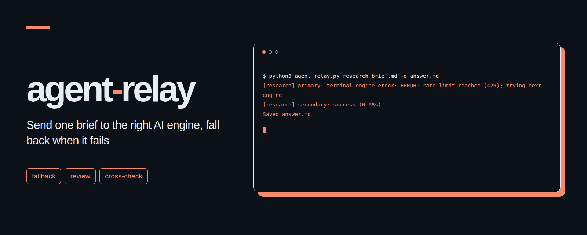

# agent-relay
<p align="center"></p>

Send one brief to the right AI engine and fall back when execution fails or returns an empty or terminal error response.

[한국어](README.ko.md)

## Why

A rate limit, disconnected process, or empty response can stop work even when another subscription or API is available. agent-relay tries an ordered list of engines for each kind of work, records why it moves on, and saves the first usable response. It does not score factual quality or catch every plausible but unhelpful answer. Review and cross modes add explicit instructions to help check the substance.

The tool is a single Python file using only the standard library. It requires Python 3.11 or later and Linux or macOS for file locks and process group timeouts. No server or package installation is needed.

## Install in three steps

1. Download this repository and enter its directory. Keep `prompts/` beside `agent_relay.py` for review mode.
2. Install and authenticate the CLI engines you want to use. For an API engine, export the environment variable named by `api_key_env`.
3. Run `cp examples/relay.toml relay.toml`, then edit the engine orders and commands. The API example has a zero budget and stays disabled until configured.

```sh
python3 agent_relay.py research brief.md -o answer.md
python3 agent_relay.py code brief.md -o answer.md -C ./project --config relay.toml
python3 -m unittest -v
```

The brief, output, and config paths are relative to the directory where you run the command. `-C` changes the engine's working directory without changing those paths. A relative `state_dir` is resolved relative to the config file. Missing commands fall through to the next engine.

## Modes

| Mode | Behavior |
| --- | --- |
| `research` | Try the configured research engines in order. |
| `code` | Try engines in order with the selected working directory. |
| `review` | Prepend the English or Korean review rules, then try engines in order. |
| `cross` | Obtain two independent answers from different engine entries, then ask the first successful engine to verify disagreements and produce the final answer and comparison table. |
| `write` | Try the configured writing engines in order. |

Review mode asks for actual, source-supported errors with file and line references, excludes nitpicks and style preferences, and requests `Findings: 0` when there is nothing to report. Set `review_language = "ko"` to use the Korean rules in `prompts/`. These rules are prompt instructions, not an enforced filesystem sandbox. Engine permissions remain controlled by each CLI's configuration.

When the output is `answer.md`, cross mode saves `answer.md.a.md` and `answer.md.b.md`. Both initial stages receive the same brief and do not see the other's answer. Intermediate files are written only after both answers finish. The comparison prompt includes both answers and asks for a final answer plus a table of disagreements, verified values, evidence, and uncertainty. If a preferred engine fails, another can supply the first answer, but the second answer must come from a different engine entry. The comparison step uses only the first successful engine and fails clearly if that engine cannot finish. Configure entries that actually point to different engines. Because the working directory is shared, independence comes from prompt and answer handling rather than filesystem isolation.

## Configuration

This minimal configuration uses two authenticated CLIs:

```toml
[relay]
max_concurrent = 4
wait_timeout = 60
timeout = 300
lock_timeout = 10
review_language = "en"
state_dir = "~/.local/state/agent-relay"

[modes]
research = ["codex", "claude"]
code = ["codex", "claude"]
review = ["codex", "claude"]
cross = ["codex", "claude"]
write = ["claude", "codex"]

[engines.codex]
command = ["codex", "exec", "--skip-git-repo-check", "--output-last-message", "{output}", "-"]
output = "file"

[engines.claude]
command = ["claude", "-p", "--output-format", "text"]
```

[The full example](examples/relay.toml) adds Gemini CLI and an OpenAI-compatible Chat Completions endpoint. API requests send `POST {base_url}/chat/completions` with a model, one user message, and `max_tokens` or `max_completion_tokens`. Only text completions are supported. API engines receive only the prompt text and cannot read the working directory or browse sources, so put the necessary source excerpts into the brief when using them.

Commands are arrays of arguments executed without a shell. The prompt is always sent through standard input. Placeholders are `{brief}` (temporary UTF-8 prompt file), `{output}` (temporary response file), `{workdir}`, `{mode}`, and `{prompt}`. Prefer stdin or `{brief}` to avoid command length limits and exposing brief text in process listings. File output requires `output = "file"` and `{output}`; otherwise stdout is used as the response. Each attempt gets fresh temporary files. A per-engine `timeout` overrides the relay default, in seconds. Engines must run in the foreground.

Engine flags are documented in the [Codex CLI source](https://github.com/openai/codex/blob/main/codex-rs/exec/src/cli.rs), [Claude Code reference](https://code.claude.com/docs/en/cli-reference), and [Gemini headless reference](https://geminicli.com/docs/cli/headless/). The API wire format follows [Chat Completions](https://developers.openai.com/api/reference/resources/chat). Check your installed CLI's help if its flags differ.

## Failure handling and limits

- Nonzero exits, timeouts, whitespace-only responses, and terminal engine diagnostics trigger fallback. A final diagnostic line such as `ERROR: quota exceeded`, `HTTP 429`, or `error: disconnected` counts as a failure. Ordinary mentions in the body, quoted diagnostics, and fenced code examples do not. Recovered errors followed by a normal final line do not count.
- The default concurrency limit is four active attempts across invocations sharing a `state_dir`. All invocations sharing it must use the same `max_concurrent`. Lock files remain in place, and the operating system releases their locks when the holder exits. A slot wait exceeding `wait_timeout` ends the run with an explicit error. Ledger locks have their own `lock_timeout`.
- CLI timeouts kill the process group. API HTTP exchanges run in a bounded worker process, including response download time. The HTTP response limit is 16 MiB. HTTPS is required except on loopback for local servers. Redirects are rejected.
- API budgets apply per engine entry, endpoint, and model, per UTC day. The locked JSON ledger is `state_dir/costs.json`. An engine is skipped if its spent cost plus outstanding reservations reaches its daily cap or cannot fit the next reservation. A zero cap disables the engine. CLI usage is not metered, including CLIs configured separately to use paid APIs.
- Before an API call, the tool reserves a conservative estimate: serialized request byte length plus 1,024 input tokens, plus the configured maximum output tokens, at your configured prices. On a valid response, it replaces that reservation with the cost computed from `usage.prompt_tokens` and `usage.completion_tokens`. Prices in the example are illustrative. Provider tokenization, hidden overhead, pricing changes, and provider-side billing can differ, so this is a local spending guard rather than a provider billing guarantee.
- A definite client rejection releases its reservation, except HTTP 408. Transport failures, server errors, redirects, missing usage, and interrupted requests retain the reservation for that UTC day because actual usage is unknown. Do not clear the ledger to retry around a cap. Back it up before correcting it from verified provider usage. A corrupt ledger stops the run instead of resetting costs.
- `answer.md.log` records engine names, elapsed time, stderr tails, costs, and fallback reasons. Recognizable key prefixes, long hexadecimal strings, bearer values, named secret fields, and secret environment values are redacted before writing. Response files and briefs are not redacted, so review them before sharing. Successful response bodies are not copied into the log.

The final output is replaced atomically only on success. Failed runs leave any previous final output in place; use the exit status and log to check whether a new run succeeded. Cross intermediates may remain if the comparison step fails. Exit status is `0` on success, `1` on a configuration or execution failure, `2` for invalid arguments, and `130` on interruption. A code engine may modify files before failing, and fallback does not undo those edits.

## Example terminal output

Illustrative output from fake engines, not a real provider run:

```text
$ python3 agent_relay.py research brief.md -o answer.md
[research] primary: terminal engine error: ERROR: rate limit reached (429); trying next engine
[research] secondary: success (0.08s)
Saved answer.md
```

## Tests

```sh
python3 -m unittest -v
```

Tests use local fake engines and a loopback HTTP server. They cover fallback order, short valid answers containing error terminology, review rules in both languages, all three cross stages, file output, concurrency and bounded waits, redaction, API token accounting, concurrent reservations, transport deadlines, redirects, and corrupt ledgers. They do not call real providers or require credentials.

## License

[MIT](LICENSE). Copyright (c) 2026 kks0488.
